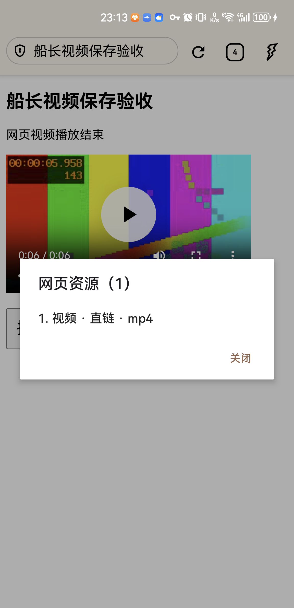
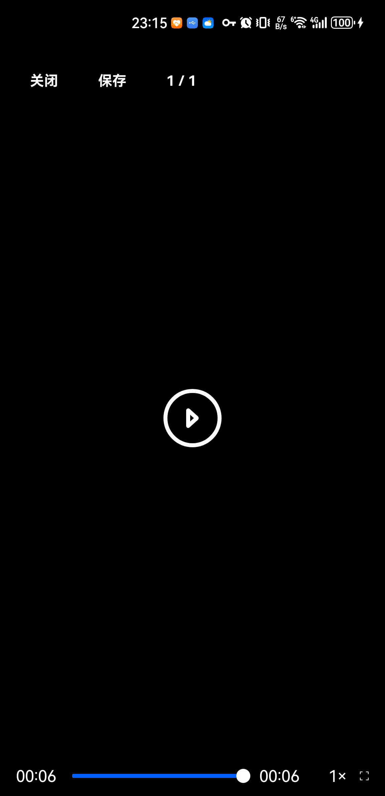
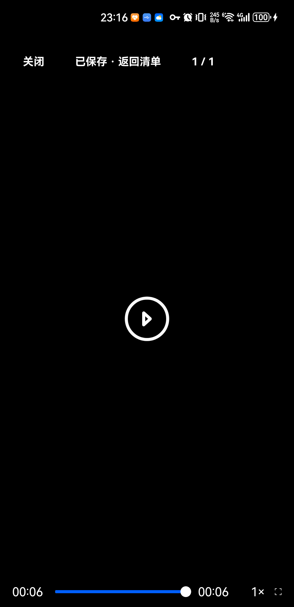
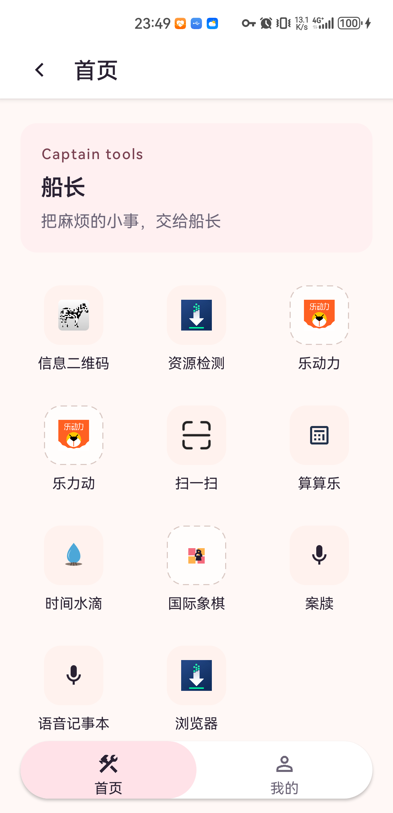

# Fulguris 接入与播放结束后保存验收

日期：2026-10-17，Asia/Shanghai。

## 结论

Fulguris 已作为库模块接入船长，首页新增“浏览器”，原“资源检测”保留。浏览器菜单“网页资源 · 播放与保存”接入船长的预览与前台保存服务。

已在 NOH-AN00 真机（Android API 31）验证普通标签的两条 MP4 路径：网页内完整播放结束后保存，以及船长预览完整播放结束后保存。两次产物均包含 H.264 视频和 AAC 音频、时长 6 秒、大小 345051 字节，与自有测试源 SHA-256 一致。

## 版本与构建

- 船长基线 HEAD：`ffafb3537abb3c29e896a4a24db0be7e9fa10dc7`，设备回执记录提交前快照。
- Fulguris：`66d56d4501575324f09621a5babcbf4bc7641118`。
- 上游独立基线 `slionsFullAgentDebug` 构建通过；临时副本已在保留回执后清理，[原版构建回执](evidence/fulguris-20261017/upstream-baseline.json)。
- 船长并存包：`com.shuqiang.captain.browser.test`，版本 `1.1.200` / `100010200`，minSdk 23。
- 最终交付已原位更新原船长 `com.shuqiang.captain`，名称“船长”，沿用原签名及应用数据；并存测试包停用，数据保留。
- 自动验证：浏览器内置脚本测试 1 项、船长媒体及浏览桥接测试 125 项，共 126 项，124 项通过、2 项可选真实站点用例因缺少授权测试素材跳过，失败和错误均为 0。
- 自动验证包含：结束/移除的视频仍可选择、标签文档候选隔离、缓存完整导出不请求网络、会话一次领取、长播放会话保活及退出后过期清理。

## 真机证据

| 路径 | 播放结束依据 | 保存结果 | 文件校验 |
| --- | --- | --- | --- |
| 网页播放器 | 页面显示“网页视频播放结束”、进度 0:06/0:06；测试服务收到 `web_playback_ended` | 系统媒体库产生 `captain_127_0_0_1_393778015_1.mp4`，owner 为并存测试包 | 6.000 秒，H.264 + AAC，345051 字节 |
| 船长预览 | 预览显示 00:06/00:06 和重播按钮 | 点击保存后产生 `captain_127_0_0_1_1717024809_1.mp4`，owner 为并存测试包 | 6.000 秒，H.264 + AAC，345051 字节；保存前后测试服务事件数均为 8，未新增媒体网络请求 |

两次导出与测试源的 SHA-256：

```text
b049fb37dd0adcd90b129d5f948dbd7bfda95450ea2f3f08fa70f76d3413bb0c
```

保存目录：`Movies/Captain/WebSniffer/`。媒体库时长字段为 6023ms，ffprobe 容器时长为 6.000 秒；不将两种口径混写。








## 修复及后续补丁的验证边界

接入过程中已修正 Application 初始化顺序、宿主 DataBinding 映射、库内脚本读取路径；修正后完成上述设备路径。

上述设备路径之后，追加预览会话保活、隐私导出门禁、关闭页面时交接异常保护，以及独立审查发现的 HTTP→本地主页旧候选清理修复；这些补丁已由最终构建与对应自动测试验证。导航清理测试先在未修复代码上复现失败，再修复并验证。长视频会话采用模拟时钟覆盖超时场景，未等待真实 15 分钟视频重做设备测试。

## 支持边界与未验项

- 普通标签 MP4 两条路径已实测；网页保存使用已发现地址和会话重新下载，未宣称 WebView 缓存可离线导出。
- 预览播放复用 Media3 缓存；完整缓存的 MP4 可不再次联网导出，缺失或已淘汰的部分仍需网络。
- 现有 HLS 引擎及其解析、加密、缓存测试通过；HLS 真机完整播放后保存未验。DASH、独立音轨、直播等仍按原支持边界处理。
- 隐私标签资源导出暂不支持；其原有浏览能力保留。
- DRM、地址已过期且缓存不完整、进程被终止后的恢复不在本次已验范围。
- 书签、会话恢复、其他船长业务未进行全量设备回归；不能用绿色单测总数代替这些场景。
- 测试源由本地 ffmpeg 生成，测试服务校验 Cookie；结论不代表所有视频站点均可下载。

## Captain 内工具项交付

用户要求直接作为 Captain 工具后，已用原签名构建并执行覆盖更新。包名保持 `com.shuqiang.captain`，首次安装时间仍为 `2026-07-10 23:20:29`。并存测试包通过 `disable-user` 停用，不清理其数据。

普通浏览器移除独立任务启动行为，菜单退出仅结束浏览器页；隐私浏览仍保留上游独立进程。普通 panic 清理显式销毁标签并阻止生命周期重新写回状态，不终止 Captain 进程；此分支由静态复审和最终构建验证，未在真机触发 panic intent。

NOH-AN00 真机验证：首页“浏览器”进入后，浏览器和船长首页同在任务 `198`；关闭标签后按返回，以及完整菜单“退出”，均回到同一船长首页实例；返回后重新进入正常。最终安装 APK 与本机构建 SHA-256 一致，详见 [宿主交付回执](evidence/fulguris-20261017/host-integration-receipt.json)。之前的两条视频保存设备证据来自并存测试包，本次宿主更新未重做完整媒体测试。

Release 构建与 `lintVitalRelease` 通过。现有 targetSdk 29 继续保留；仅排除 Google Play 的 `ExpiredTargetSdkVersion` 发布策略检查，其他 fatal 检查保留。该包用于本地安装，未向商店发布。



## 范围保护

工作区既有语音、案牍联动、备份与相关文档改动均保留。已原位更新手机上的船长；本报告记录提交前设备验收快照，不代表商店发布。

提交前以临时索引导出仅包含浏览器必要改动的独立候选树，排除案牍、语音联动及备份改动后，执行 `:browser:testDebugUnitTest :captain:testDebugUnitTest`（仅 xhs/browser 测试）：124 项通过、2 项可选用例跳过，失败与错误均为 0。本轮提交验证未操作设备。
